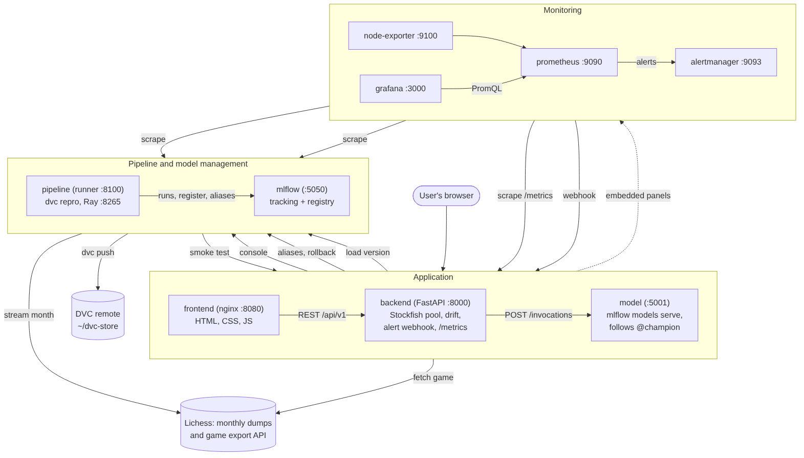

# Architecture

Nine services run on one Docker Compose network.
Four of them (`mlflow`, `model`, `backend`, `pipeline`) use the same Python image with different
commands; `frontend` is its own nginx image; the four monitoring services use the official images.

## Blocks

### Application

| Block | What it does | Talks to |
|---|---|---|
| **frontend** (nginx, port 8080) | Serves three static pages: Analyse, Pipeline console, Help. nginx forwards `/api/` to the backend, so the page only knows one address, set in `config.js`. External POSTs to the alert webhook are refused here. | backend (REST) |
| **backend** (FastAPI, port 8000) | The single API for the web page. For a prediction it reads the game (pasted PGN, or a Lichess link it fetches), checks it with the same rules as training, runs Stockfish with the same feature code as training, calls the model server, and returns the range and reasons. It also proxies the pipeline console, reads and moves model aliases, receives alerts, computes drift, probes every component's health, and exposes `/metrics`. | model, mlflow, pipeline, Lichess |
| **model** (port 5001, internal) | `mlflow models serve` for the version that `@champion` points to. `serve_champion.py` checks the alias every 30 s and restarts the server on a new version, so promotions and rollbacks need no manual restart. | mlflow |

The frontend and the model are fully decoupled: the page never calls the model, and the backend
calls the model only through its REST endpoint (`MODEL_URL`), so either can be replaced on its own.

### Pipeline and model management

| Block | What it does | Talks to |
|---|---|---|
| **pipeline** (runner, port 8100; Ray dashboard 8265) | Runs `dvc repro` when the console (or an alert) asks, one run at a time, and keeps a history with per-stage times, logs, throughput and the promotion decision. It exposes these as Prometheus metrics. The six stages are in `dvc.yaml`. validate uses Ray tasks; featurize uses a pool of Ray actors, each with its own Stockfish process. After a successful run it pushes data and models to the DVC remote. | Lichess, mlflow, backend (smoke test), DVC remote |
| **mlflow** (port 5050 on the host) | Tracking server (SQLite) and model registry, with artifacts served through the server. Every training run logs its parameters (including the Git commit and a hash of the feature file), metrics, charts and the drift reference; every registered version carries its test MAE and promotion decision as tags. Aliases: `@challenger` (newest), `@champion` (serving), `@previous` (for rollback). | |
| **DVC remote** (`~/dvc-store`) | A folder outside the repo holding versioned copies of the data and models listed in `dvc.lock`. | |

### Monitoring

| Block | What it does |
|---|---|
| **prometheus** (9090) | Scrapes backend, pipeline runner, MLflow, node-exporter, Alertmanager, Grafana and itself every 15 s; evaluates the alert rules in `monitoring/alerts.yml`. |
| **node-exporter** (9100) | CPU, memory and disk of the host (on macOS, the Docker Desktop VM). |
| **alertmanager** (9093) | Groups alerts and sends them to the backend webhook, which lists them on the console and can start retraining. |
| **grafana** (3000) | The "Guess the Rating" dashboard, provisioned from `monitoring/grafana/`. Four panels are embedded in the pipeline console. |

The model server has no metrics endpoint of its own; it is monitored through the backend, which
probes it every 15 s (`chess_component_up{component="model"}`) and times every call to it.

## Main flows

1. **Prediction**: browser → frontend → backend → (Lichess) → Stockfish pool in the backend → model `/invocations` → backend → browser.
2. **Pipeline run**: console → backend → runner → `dvc repro` (ingest → validate → featurize → train → evaluate → promote) → MLflow registry → model server reloads → smoke test through the backend.
3. **Monitoring loop**: backend metrics → Prometheus → alert → Alertmanager → backend webhook → (if `AUTO_RETRAIN=true`) runner starts a run on the next month.
