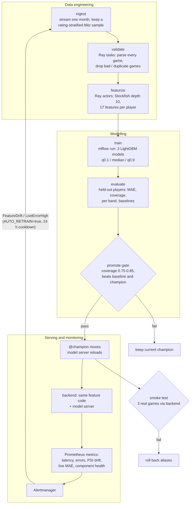

# High-level design

Source: [hld.mmd](hld.mmd).

## 1. Problem and success metrics

Chess players often wonder how strong an opponent (or they themselves) played in one game. Ratings
only move slowly, over many games. The app estimates a player's Lichess **blitz** rating from **one**
game, as a range, and says why.

| Metric | Why | Target (acceptance criteria in test_plan.md) |
|---|---|---|
| MAE of the middle estimate (rating points) | Main accuracy measure; easy to explain | Better than both baselines (constant median, straight line on ACPL) |
| Coverage of the low-high range | The range claims 80%; it should be honest | 75% to 85% of real ratings inside the range |
| Within-200 share | A user-friendly view of accuracy | Reported, no target |
| p95 prediction time | Users wait while Stockfish runs | Under 5 s for an 80-ply game |

## 2. Data

- **Source**: the Lichess open database (CC0), one compressed PGN file per month, plus the Lichess game
  export API for single games entered by users. Both write the same moves and clock comments;
  headers differ slightly (`tests/test_parse.py` checks both with the same real game).
- **Sample**: blitz only (Lichess rule: base + 40 x increment between 180 and 479 seconds), rated, standard,
  no bot players, normal or time-forfeit endings. Ingest keeps up to `games_per_band` games per rating band
  (by average rating), so strong and weak players are not drowned out by the 1200-1800 majority.
- **Validation**: every game is fully parsed; games shorter than 20 plies, without clocks, with odd starting
  clocks (tournament berserk) or duplicated are dropped and counted by reason (`reports/validation.json`).
- **Split**: by player, with a hash of the player name, 70/15/15. One player never appears in two splits,
  and the same player lands in the same split every month, so a later month's test set stays unseen.

### Known biases and limits

- Lichess ratings are not FIDE or chess.com ratings; the app says "Lichess blitz rating".
- Rating bands are balanced in sampling, but the extremes (below 800, above 2400) have fewer games, so
  their error is higher (see per-band MAE in `reports/metrics.json`).
- One game is noisy: tilt, a time scramble or a short game can mislead the model. The range shows this.
- Players who play many games are more likely to be sampled; the split by player prevents leakage
  but not this over-representation.
- Engine depth 10 is weaker than full-strength analysis; strong players' accuracy is underestimated
  a little, but consistently, because training and serving use the same depth.

## 3. Features (src/chessfeat/features.py)

17 numbers per player per game, computed by the same function in training and serving:

- **Move quality** from Stockfish depth 10 (first 120 plies): average centipawn loss overall and in the
  opening, middlegame and endgame; blunder, mistake and inaccuracy rates; share of engine-best moves.
- **Clock use**: share of the time used, mean time per move, how uneven move times are, moves made with
  under 10 s, lost on time.
- **Context**: colour, game length, result, opening family (ECO letter).

Ratings, rating differences and names are never inputs (`test_no_rating_information_in_model_inputs`).
Determinism: one Stockfish thread, a fresh hash per game (`ucinewgame`), fixed depth. Without this the same
game gave different features under Ray (found and fixed early in the project).

## 4. Model

Three LightGBM models on the same features: the 10th percentile (quantile loss), the median (L1 loss) and
the 90th percentile. Together they give an estimate and an 80% range. Why:

- Gradient-boosted trees are strong on small tabular data, train in seconds, and need no scaling.
- Quantile models give a range directly, without assuming a normal error.
- LightGBM's `pred_contrib` gives per-prediction feature contributions (SHAP values for trees),
  which become the three "reasons" shown to the user.

The three boosters are packaged as **one MLflow pyfunc model** (`RatingRangeModel`) with a signature,
pinned requirements and the `chessfeat` code, so the model server needs nothing else.

## 5. Pipeline, versioning and CI

- **DVC** defines the six-stage DAG (`dvc.yaml`) with all settings in `params.yaml`. `dvc repro` reruns only
  stages whose code, data or params changed. Data and models are DVC outputs pushed to a local remote;
  `dvc.lock` in Git pins their hashes. Metrics and plots are DVC metrics and plots; tuning uses `dvc exp run`.
- **Ray** does the heavy data engineering: validate is split into Ray tasks; featurize uses a pool of Ray actors,
  each owning one Stockfish process (an engine cannot be shared between processes).
- **MLflow** tracks every training run (`mlflow run . -e train`, from the `MLproject` with `python_env.yaml`),
  beyond autolog: month, sample size, Stockfish version and depth, Git commit, feature-file hash, the
  three models' best iterations, validation and test metrics, per-band MAE, charts and the drift reference.
- **CI**: a Git pre-push hook runs flake8, pytest and `dvc status`. The pipeline itself (via `dvc repro`) is the
  continuous training part, and the promotion gate plus smoke test are the deployment checks.
- **Reproducibility**: any model version links to its MLflow run, whose `git_commit` parameter and the
  matching `dvc.lock` give the code, data and settings that produced it.

## 6. Promotion, serving and rollback

1. evaluate scores the new model (`@challenger`) on this month's test players.
2. promote loads the current `@champion` and scores it on the same players (fresh data for both).
3. Gate: coverage within 0.75-0.85, better than the constant baseline, and MAE at least 5 points better than
   the champion. If it passes, `@previous` = old champion and `@champion` = new version.
4. The model server notices the alias within 30 s and restarts on the new version.
5. Smoke test: three real games through the running backend must come back from the new version with
   ordered ranges. If not, the aliases are restored automatically. A manual rollback is on the console.

Why aliases and not a "production" stage: MLflow 2.9+ deprecated stages; aliases are explicit and make
rollback a one-line change.

## 7. Monitoring and automatic retraining

- Every component is scraped by Prometheus or probed by the backend (model server, frontend).
- Model health: rolling live MAE and coverage on games whose real rating is known (Lichess games carry
  the players' ratings), once 30 are known, compared with the registered test MAE.
- Data drift: PSI of ACPL, mean move time and game length over the last 200 players vs the training
  data (reference saved by train), once 100 players are in the window.
- Alerts go through Alertmanager to the backend. With `AUTO_RETRAIN=true`, FeatureDrift or LiveErrorHigh
  starts a run on the next month (24 h cooldown, so a persistent alert cannot loop).

## 8. Software design: functional core, objects for state

- **Functional**: rules, parsing, features, metrics, drift, the split and the promotion gate are pure
  functions (input in, result out, no hidden state). This is most of the code and makes it easy to test.
- **Object-oriented** where there is state to own: `Analyzer` (one Stockfish process), `GameValidator`
  (seen IDs and rejection counts), `RatingRangeModel` (the loaded boosters), `FeatureWorker` (a Ray actor),
  and in the backend `AnalyzerPool`, `LiveMonitor` and `PredictionLog`.
- Stages are small scripts with a `main()`; shared helpers live in `src/common.py`.

## 9. Security

- Admin actions (start run, rollback) need `X-Admin-Token`, compared in constant time.
  Without a configured token they are disabled.
- The prediction log is encrypted with Fernet (AES-128 + HMAC); player names are not stored.
- Secrets come from `.env`, which is not committed (`.env.example` documents them).
- The alert webhook is reachable only inside the Docker network (nginx refuses external POSTs).
- MLflow's `--allowed-hosts` limits which Host headers it accepts.
- Inputs are validated (size limits, patterns, ranges); bad input gets a 4xx with a plain message.
- Limits: no HTTPS or user accounts (a local deployment); Grafana allows anonymous read-only viewing so
  panels can be embedded; MLflow has no authentication.

## 10. Scalability

- Featurize scales with CPU cores (one actor per core); on a cluster the same code runs on more Ray nodes.
- The backend's Stockfish pool size is a setting (`ANALYZERS`); more backend replicas could sit behind nginx,
  but the in-memory drift window would then need to move to a shared store (one replica keeps metrics simple).
- Ingest streams the monthly file and stops early, so it never stores the full download (tens of gigabytes compressed).
