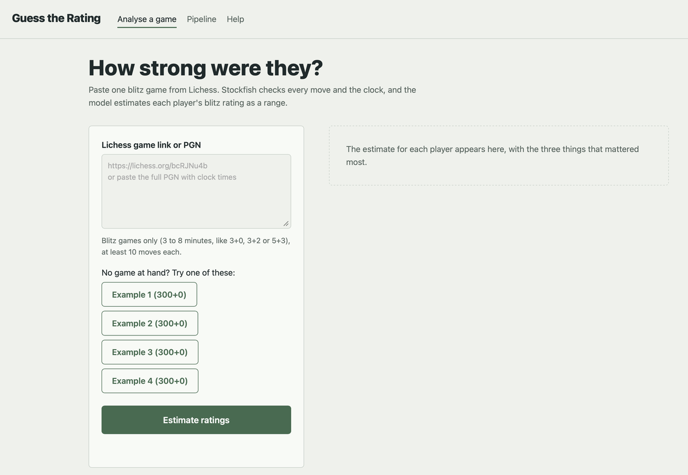
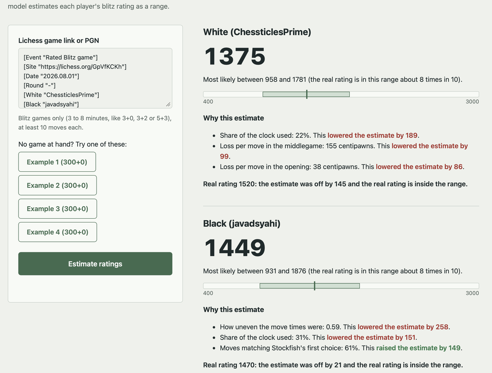
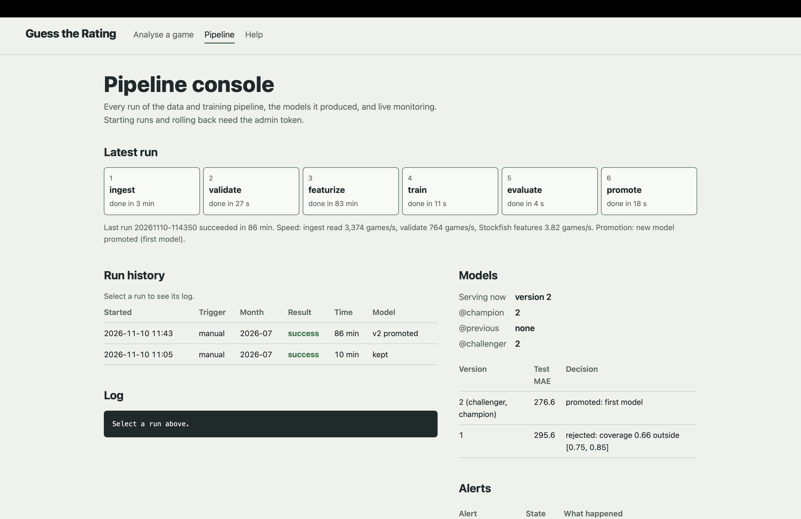

# User manual

Guess the Rating looks at one chess game and estimates how strong each player is, as a Lichess
blitz rating. You do not need to know anything about computers or machine learning to use it.

## Start the app

Whoever installed the app (see the README) starts it with `docker compose up -d`. Then open
**http://localhost:8080** in a web browser (Chrome, Safari, Edge or Firefox) on that computer.

## Estimate the ratings in a game

1. Find a finished **blitz** game on lichess.org (3 to 8 minutes per side, for example 3+0, 3+2, 5+0 or 5+3).
   Copy the address from the browser's address bar, for example `https://lichess.org/bcRJNu4b`.
   You can also copy the game's PGN (on Lichess: Share & export, then Download PGN or copy it).
2. Paste it into the box **Lichess game link or PGN**. No game at hand? Press one of the **Example** buttons.
3. Press **Estimate ratings** and wait a few seconds while the chess engine checks every move.

## Read the result

For each player:

- **The big number** is the best single estimate.
- **"Most likely between ... and ..."** is the range. The real rating falls inside it about 8 times in 10.
- **The bar** shows the range as a green band on a scale from 400 to 3000, with a mark at the estimate.
- **Why this estimate** lists the three things that moved the estimate most, and by how many points.
  For example "Average loss per move: 23 centipawns. This raised the estimate by 88 points."
  A centipawn is a hundredth of a pawn: losing 100 centipawns in a move is like giving away a pawn.
  Strong players lose fewer.
- **Show real rating** appears when the game has the players' ratings (Lichess links always do). It tells you how far
  off the estimate was and whether the real rating is inside the range.

The page also adapts to narrow screens such as phones.

## Messages you may see

| Message | What it means | What to do |
|---|---|---|
| Paste a Lichess game link or a PGN first | The box is empty | Paste a link or PGN |
| That does not look like a Lichess game link | The address is not a Lichess game | Copy the address of the game page itself |
| This is not a blitz game | The game was bullet, rapid or classical | Choose a blitz game |
| The game is too short | Fewer than 10 moves each | Choose a longer game |
| The PGN has no clock times | The PGN was saved without clocks | Paste the Lichess link instead |
| Lichess has no game with that ID | The link is wrong or the game was deleted | Check the link |
| All analysis engines are busy | Many people are using the app | Try again in a few seconds |
| The model server is not answering | A new model is being loaded | Try again in a minute |
| Cannot reach the server | The app is not running | Ask whoever runs it to start it |

## Things to keep in mind

- One game is a small sample. If someone played unusually well or badly, the estimate will be off.
- The estimate is a **Lichess blitz** rating. Ratings on other sites or in other time controls are on different scales.
- Games against computers and tournament games where a player "berserked" (halved their clock) are not supported.

## For the person running the app: the Pipeline page

Open **Pipeline** in the menu (http://localhost:8080/pipeline.html).

- **Latest run** shows the six steps of the last training run (get games, check them, analyse them with the engine,
  train, test, and decide whether to use the new model), how long each took, and the speed.
- **Run history** lists every run with what started it (you, or an alert), the month of games used, and the result.
  Select a run to read its log underneath.
- **Models** shows which model version is answering now, which one is kept for rollback (@previous), and each version's
  test error and the decision about it.
- **Alerts** lists warnings from the monitoring system and what was done about them. If `AUTO_RETRAIN=true` is set in
  the `.env` file, the app retrains by itself when live games start to look different from the training games, or when
  its error on real games grows (at most once a day).
- **Admin** (needs the admin token from the `.env` file):
  - **Start pipeline run**: "Same month" re-runs only what changed; "Next month" trains on newer games; or choose a month.
  - **Roll back to the previous model**: puts the previous model back within a minute.
- **Live monitoring** shows charts from Grafana, and **Open the tools** links to MLflow, Grafana, Prometheus,
  Alertmanager and the Ray dashboard.

## Privacy

The app stores each prediction in an encrypted file so its accuracy can be checked later.
Player names are not stored.
